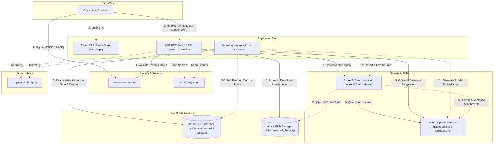
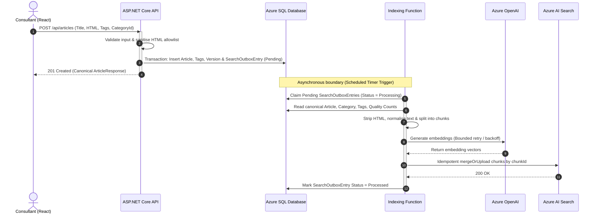
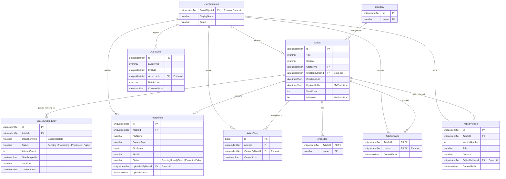

# Brownfield Consulting Knowledge Base Architecture

## 1. Executive Summary

Brownfield Consulting needs an internal knowledge base to replace a shared drive holding over 2,000 unstructured Word documents and PDFs. This proposal defines an Azure architecture to deliver a minimum viable product (MVP) and live demonstration within four weeks for approximately 200 consultants.

The design pairs a React and TypeScript single-page application (SPA) on Azure Static Web Apps with an ASP.NET Core (.NET 10) Web API on Azure App Service. Azure SQL Database is the canonical system of record, and Azure Blob Storage stores attachment binaries. Search uses Azure AI Search hybrid retrieval, combining keyword matching with vector similarity via Azure OpenAI embeddings so consultants can locate exact project identifiers and conceptually related guidance. During authoring, an optional Azure OpenAI structured completion suggests categories from a fixed taxonomy for author confirmation. Core authoring and reading commit synchronously to Azure SQL alongside a transactional outbox entry, keeping the application available during transient AI or search failures.

---

## 2. Context, Constraints and Assumptions

- **Scale and Latency**: Built for approximately 200 consultants; expected peak concurrency and usage patterns require customer confirmation. End-to-end search latency should be measured using representative consultant queries, an acceptable target agreed with the customer after an early technical spike, and telemetry separated across API, embedding/vectorisation, and Azure AI Search dependency latency.
- **Content and Delivery Window**: Approximately 2,000 unstructured Word and PDF files on a shared drive, with a four-week constraint for the MVP and demonstration.
- **Technology Alignment**: The back end uses .NET (C# and ASP.NET Core) for maintainability by Brownfield Consulting's team. Existing SQL Server licensing applies via Azure Hybrid Benefit, and an Azure OpenAI resource is provisioned.
- **Identity and Resilience**: Authentication uses Microsoft Entra ID. AI and search features degrade gracefully without blocking reading or authoring.
- **Customer Name Assumption**: The brief refers to Brownfield Consulting in the main scenario and Greenfield Consulting in a later section; **Brownfield Consulting** is used throughout.
- **Front-End Maintenance Assumption**: Internal capacity to maintain TypeScript and React is unconfirmed. React is recommended for its rich-text and search UI ecosystem, but this choice should be revisited if maintainers are exclusively .NET-focused.
- **Residency, Networking and GA Assumption**: Target Azure regions, compliance boundaries, and private networking rules require customer confirmation. The MVP uses generally available (GA) capabilities only; preview features (such as preview agentic retrieval modes in Azure AI Search) are excluded from the MVP foundation.

### Clarification Questions for the Customer

1. **Front-End Capability**: Does the internal team have React and TypeScript maintenance skills, or is a C#-only stack (Blazor) preferred despite rich-text editor trade-offs?
2. **Region and Quotas**: Which Azure region hosts the Entra tenant and Azure OpenAI resource, and what model deployments and quotas exist?
3. **Document Profile**: What share of the 2,000 legacy files are scanned PDFs requiring OCR, and do any files require restricted per-document access control?
4. **Network Policy**: Are public endpoints secured by Entra ID and TLS acceptable for the MVP, or are Azure Private Endpoints mandatory?

---

## 3. Architecture Overview

The architecture separates synchronous user transactions from asynchronous indexing and document extraction.



1. **Synchronous Authoring and Reading**: Consultants sign in via MSAL in React against Microsoft Entra ID [[1]](#15-references) and call the ASP.NET Core API on Azure App Service [[2]](#15-references). Creating or updating an article writes canonical records, version snapshots, and a `SearchOutboxEntry` row in one Azure SQL transaction [[3]](#15-references), [[13]](#15-references).
2. **Synchronous Category Suggestion**: On author request, the API sends a truncated plain-text excerpt and allowed categories to Azure OpenAI using structured outputs [[4]](#15-references). The author confirms or overrides the suggestion before saving.
3. **Synchronous Hybrid Search**: The API queries Azure AI Search [[5]](#15-references), which runs keyword and vector retrieval (via integrated query vectorisation with Azure OpenAI) [[6]](#15-references), merges results via Reciprocal Rank Fusion (RRF), applies filters and quality boosts, and returns matched excerpts. Opening a result fetches the canonical article from Azure SQL.
4. **Asynchronous Indexing**: A scheduled Azure Function polls pending SQL outbox rows [[7]](#15-references), chunks article text, generates embeddings via Azure OpenAI [[8]](#15-references), and upserts chunks into Azure AI Search. Attachment binaries in Azure Blob Storage [[9]](#15-references) are indexed asynchronously via Azure AI Search Blob indexers and skillsets [[10]](#15-references).

---

## 4. Component Choices and Trade-offs

- **Front End (React with TypeScript on Azure Static Web Apps)**: Hosts the SPA for rich-text authoring, attachment uploads, search/filtering, and category suggestion confirmation [[11]](#15-references). *React vs Blazor*: Blazor shares C# across the stack, whereas React offers a stronger ecosystem for rich-text editors, paste sanitisation, and MSAL integration without JavaScript interop wrappers. Maintaining both TypeScript and .NET is a trade-off; if maintainers are exclusively .NET-focused, this choice should be revisited in favour of Blazor.
- **Back End (ASP.NET Core on .NET 10, Azure App Service)**: Controller-based Web API across `Api`, `Core`, and `Infrastructure` [[2]](#15-references). *App Service vs Containers/Kubernetes*: App Service provides managed TLS, deployment slots, autoscaling, and Managed Identity with low overhead. AKS, service meshes, API Management (unless external gateway policies justify it), and microservices are rejected as disproportionate for approximately 200 consultants and a four-week window.
- **Transactional Data (Azure SQL Database)**: System of record for articles, categories, tags, versions, attachment metadata, upvotes, views, audit events, and outbox rows [[3]](#15-references), accessed via EF Core 10 and eligible for Azure Hybrid Benefit. The search index is derived data rebuildable from canonical sources.
- **Attachments (Azure Blob Storage and Conditional Extraction)**: Blob Storage stores binaries [[9]](#15-references) while SQL tracks metadata and ownership. Azure AI Search Blob indexers and skillsets extract Word and text-based PDFs [[10]](#15-references). Document Intelligence is used conditionally only for scanned or layout-heavy PDFs, avoiding mandatory OCR on every file.
- **Search and AI (Azure AI Search and Azure OpenAI)**: Azure AI Search handles keyword, vector, and hybrid retrieval with metadata filtering [[5]](#15-references), [[12]](#15-references), while Azure OpenAI provides embeddings and structured completions [[4]](#15-references), [[8]](#15-references) without a separate vector database.
- **Asynchronous Indexing (Azure Functions and SQL Outbox)**: A scheduled Function processes `SearchOutboxEntries` written transactionally in SQL [[7]](#15-references), [[13]](#15-references). *SQL Outbox Polling vs Azure Service Bus*: Service Bus adds operational overhead while still needing an outbox relay to prevent dual-write bugs. Polling SQL on a short schedule trades immediate indexing freshness for operational simplicity and low cost; Service Bus is deferred unless high throughput, fan-out, or independent consumers justify it later.

---

## 5. Core Application Flows

- **Synchronous vs Asynchronous Boundaries**: Authentication, authorisation, article create/update transactions, article retrieval, search requests (including query vectorisation), author-requested category suggestions, and attachment upload initiation/validation run synchronously with timeouts, cancellation, limited retries, fallback, and latency telemetry. Article/attachment indexing, stored-content embeddings, extraction, re-indexing, migration, retry/recovery, and cleanup run asynchronously.
- **Authentication and Authorisation**: React signs in via MSAL and passes `access_as_user` Bearer tokens to the API [[1]](#15-references), which validates tokens with `Microsoft.Identity.Web`, keys identity to the Entra `oid`, and enforces `Consultant` and `Administrator` roles server-side.
- **Article Creation and Editing**: `POST /api/articles` and `PUT /api/articles/{id}` validate fields, verify ownership (author `oid` or `Administrator`), sanitise HTML against an allowlist, and commit `Article`, `ArticleTag` rows, `ArticleVersion`, and a `Pending` `SearchOutboxEntry` in one SQL transaction without blocking on AI or search.
- **Attachment Upload**: Controlled API-mediated uploads (or short-lived delegated SAS URLs to a staging container) validate ownership, file type (`.docx`, `.pdf`), and size limits. Uploaded blobs are malware-scanned (Defender for Storage) before release and indexing.
- **Article Retrieval and View Tracking**: `GET /api/articles/{id}` fetches the canonical article from SQL, atomically increments `Article.ViewCount` (`ExecuteUpdateAsync`), and records an `ArticleView` row with viewer `oid` and timestamp.
- **Upvoting**: `POST /api/articles/{id}/upvote` inserts an `ArticleUpvote` row keyed by `(ArticleId, UserId)` with SQL unique constraints for concurrency idempotency, and queues an outbox quality-signal update.
- **Administrative Deletion**: `DELETE /api/articles/{id}` requires `Administrator`, soft-deletes the article in SQL, logs an `AuditEvent`, and queues a `Delete` outbox entry to purge chunks from Azure AI Search.

---

## 6. AI-Powered Search

### Indexing Model, Chunking and Shared Article Results

Article bodies and attachments populate one Azure AI Search index via two asynchronous paths:

- **Article Bodies**: The scheduled Function claims pending SQL outbox rows, loads canonical article and attachment metadata, strips HTML, normalises and chunks text, generates embeddings via Azure OpenAI, upserts search chunks, and marks the outbox entry complete.
- **Attachments**: Upload stores `ArticleId` and `AttachmentId` as Blob metadata on the binary. Azure AI Search Blob indexers and skillsets extract Word and text-based PDFs, chunk content, generate embeddings [[6]](#15-references), [[10]](#15-references), and map those identifiers into search-index fields so individual attachment chunks retain `parentArticleId` and `attachmentId`. Document Intelligence is used only for scanned or layout-heavy files when standard extraction is insufficient. Indexer execution results are monitored by the indexing worker or a small reconciliation process; failed extraction updates `Attachment.Status` in SQL through application-controlled processing and creates an operational exception for retry or manual review, while the parent article remains available.

Each indexed chunk stores `chunkId` (deterministic key), `parentArticleId`, `attachmentId`, `title`, `chunkText`, `contentVector`, `categoryName`, `tags`, `canonicalUrl`, `updatedAtUtc`, and quality signals (`upvoteCount`, `viewCount`). Under the shared-read-access model, `allowedPrincipals` is omitted from the initial index. Because all chunks carry `parentArticleId`, result processing collapses chunk hits into article-level summaries with the best matching excerpt, and clicking a result opens the canonical article from Azure SQL.

The same compatible embedding model must be used for indexing and querying; `text-embedding-3-small` is an example candidate subject to evaluation, availability, cost, region, and lifecycle review [[8]](#15-references).



### Hybrid Search and Synchronous Query Flow

The MVP uses **hybrid search** combining keyword (BM25) and vector retrieval [[5]](#15-references). Keyword search matches exact names, acronyms, identifiers, and specialist terms, while vector search matches conceptually related content when wording differs (for example, matching a query on handling difficult stakeholders to an article on client relationship management). Embeddings capture statistical patterns rather than human understanding, so Azure AI Search merges both result sets via Reciprocal Rank Fusion (RRF) [[5]](#15-references).

#### Synchronous Query Flow

1. React sends search text and filters to the API, which validates the request and authorisation context.
2. The query is vectorised with the configured embedding model; **Azure AI Search integrated vectorisation** is preferred where service capability, networking, and operational rules permit it [[6]](#15-references), while application-managed vectorisation is used only if custom orchestration requires it.
3. Azure AI Search executes keyword and vector retrieval together and merges results via hybrid RRF ranking [[5]](#15-references).
4. Optional semantic ranking may rerank candidate results if enabled [[14]](#15-references).
5. Category and tag filters are applied, collapsing chunks by `parentArticleId` (access filters are added only if restricted articles are introduced later).
6. The API returns article-level summaries and matched excerpts; opening a result fetches the canonical article from Azure SQL.

### Ranking Signals, Evaluation and Graceful Degradation

Relevance remains the primary ranking signal, with quality boosts acting as secondary signals so popular general content cannot outrank relevant specialist content.

Starting hypothesis, subject to relevance evaluation:

```text
FinalScore =
    HybridRelevance
    + SmallUpvoteBoost
    + SmallerLogarithmicViewBoost
```

Recency applies only where the content domain benefits from it. Ranking changes and the optional semantic ranker are evaluated against a representative query set, expected relevant articles, zero-result rate, click-through behaviour, user feedback, and before/after comparison of measured search latency (separating API, vectorisation, and Azure AI Search dependency latency). Automated relevance learning is excluded from the MVP.

If query vectorisation fails, the API performs keyword-only Azure AI Search and labels telemetry as degraded. If Azure AI Search is unavailable, the API falls back to the existing EF-backed SQL search (`EfArticleSearchService`) for basic title, content, tag, and category matching (without vector search, semantic ranking, excerpts, or equivalent relevance) and indicates degraded search capability in the API and UI. If the fallback is unavailable, the API returns a `503` `ProblemDetails` response. Direct article retrieval continues when SQL is available.

---

## 7. AI-Assisted Category Suggestion

Embeddings suit similarity retrieval, whereas selecting a category from a fixed taxonomy suits a constrained Azure OpenAI chat/completion model using **Structured Outputs** [[4]](#15-references):

1. The author enters the title and content in React and requests a category suggestion (or the UI triggers one once sufficient content is present).
2. The API sends the title, plain-text content truncated within safe limits, and the allowed category IDs and names from SQL.
3. The model returns structured JSON with `suggestedCategoryId`, `confidence`, and a short `explanation` [[4]](#15-references).
4. The UI displays the suggestion; the author accepts it or selects another category, which is saved as ordinary structured data.

The model chooses only from existing categories, cannot silently create categories or save selections, and never blocks article creation if unavailable. Calls use a short, configurable timeout, cancellation propagation, and limited retry only for safe transient failures, falling back to manual category selection on timeout, error, low confidence, or malformed output. Logs omit full article text to protect sensitive content.

---

## 8. Data Model

Azure SQL Database uses the Microsoft Entra object ID (`oid`) as the external user identifier rather than a password-based user table.



- **Existing API Entities**: `Article`, `Category`, `ArticleTag` (`ArticleId, Name`), and `ArticleUpvote` (`ArticleId, UserId`).
- **Proposed MVP Additions**: `UserReference` (optional profile cache keyed by Entra `oid`), `ArticleVersion` (content snapshots and editor `oid`), `Attachment` (Blob metadata, ownership, scan/extraction state), `ArticleView` (per-view history complementing `Article.ViewCount`), `AuditEvent` (administrative/security events), and `SearchOutboxEntry` (outbox queue state).

---

## 9. Security, Privacy and Audit

- **Identity and Access**: Microsoft Entra ID authenticates users via MSAL and `Microsoft.Identity.Web` [[1]](#15-references). Authenticated consultants can read, search, and upvote; authors can update their own articles; `Administrator` users can update or delete any article. The API is the access authority; UI hiding is non-authoritative.
- **Service Security**: Managed identities (`DefaultAzureCredential`) secure service-to-service calls across App Service, Functions, SQL, Blob Storage, AI Search, and OpenAI [[15]](#15-references). Key Vault stores genuine secrets [[16]](#15-references). HTTPS is mandatory, with Private Endpoints optional where compliance demands private networking.
- **Uploads and Rich Text**: HTML is sanitised against an allowlist. Uploads validate ownership, MIME type, and size, using private Blob containers and malware scanning before general availability.
- **AI Privacy and Security Trimming**: Prompts and embeddings go to the customer's Azure OpenAI resource; data residency, regional routing, resource configuration, and service terms require customer validation [[4]](#15-references). Under the MVP shared-read-access model, `allowedPrincipals` is omitted from the initial index. If restricted articles are introduced later, access metadata and server-side search security trimming (enforced in the API, never only in React) become mandatory before those articles are indexed.
- **Audit and Retention**: `ArticleVersion` tracks edits, `ArticleView` tracks view history (with rolling retention), and `AuditEvent` tracks administrative/security actions without duplicating records across all three tables.

---

## 10. Reliability and Operations

Saving to Azure SQL and indexing in Azure AI Search cannot share one transaction. Writing a `SearchOutboxEntry` in the same SQL transaction prevents committed changes from being lost before indexing [[13]](#15-references). Because retries occur, the worker uses deterministic chunk IDs (`{ArticleId}_{ChunkIndex}`) and idempotent `mergeOrUpload` upserts [[17]](#15-references):

- **Azure OpenAI down during category suggestion**: Short, configurable timeout, cancellation propagation, and limited transient retry, falling back to manual category selection without blocking save.
- **Embedding rate-limited (HTTP 429) during indexing**: Honours `Retry-After` with bounded backoff; entry stays `Pending` for the next run.
- **Azure AI Search down during search**: Falls back to EF-backed SQL search (`EfArticleSearchService`) for basic title, content, tag, and category matching, indicates degraded search in the API/UI, or returns `503` `ProblemDetails` if unavailable; direct article retrieval continues when SQL is available.
- **Indexing fails after article creation**: Article stays committed in SQL; outbox increments `AttemptCount` and sets `NextRetryAtUtc`.
- **Attachment extraction fails**: The indexing worker or reconciliation process monitors Blob indexer status, sets `Attachment.Status` to `ExtractionFailed` in SQL via application logic, and logs an operational exception for retry or manual review while the parent article remains available.
- **Duplicate outbox execution**: Prevented by SQL row locking (`UPDLOCK, READPAST`) and idempotent `mergeOrUpload` chunk keys.
- **Poison work item**: Exceeding max attempts sets status to `Failed` with `LastError` in SQL and triggers an alert without blocking other items.
- **SQL or Blob Storage unavailable**: SDK retries transient errors; sustained outages return RFC 7807 `503 Service Unavailable`.

Application Insights tracks structured logs, correlation IDs, separated dependency latency (API, embedding/vectorisation, and Azure AI Search), Function executions, zero-result rates, outbox backlog age, failed indexing counts, and AI token usage [[18]](#15-references). Alerts fire on sustained indexing failures or growing backlog age, and operators can re-queue `Failed` SQL rows manually once resolved.

---

## 11. MVP Scope and Deferred Capabilities

### Included in the Four-Week MVP

- Entra ID sign-in (MSAL in React, `Microsoft.Identity.Web` in API) and React authoring/search UI on Azure Static Web Apps.
- Create, read, update, and administrator soft-delete workflows with server-side HTML allowlist sanitisation.
- Category/tag management, attachment upload, malware scan state handling, and Blob Storage integration.
- Hybrid keyword and vector search in Azure AI Search with category and tag filters.
- Author-confirmed category suggestions via Azure OpenAI structured outputs.
- Idempotent upvotes, atomic view tracking with view history, article versions, and security/admin audit events.
- Asynchronous SQL outbox indexing via Azure Functions and Blob indexers, Application Insights alerts, and resumable migration batch tooling.

### Deferred or Conditional

- Conversational answers, RAG chat responses, personalised feeds, and automated article summaries.
- Automatic category creation by the AI model, advanced approval workflows, and complex per-document ACLs.
- Model fine-tuning, continuous learning-to-rank, and custom analytics platforms.
- Azure Service Bus (unless operational need emerges), multi-region active-active hosting, and broad semantic ranker enablement prior to relevance and cost evaluation.

### Proposed Four-Week Delivery Sequence

1. **Sequence 1**: Validate risky integrations (Entra ID, SQL schema, AI Search vectorisation, and Blob extraction spikes).
2. **Sequence 2**: Complete core authoring, HTML sanitisation, attachments, update/delete flows, and article retrieval.
3. **Sequence 3**: Add hybrid search, outbox indexing, and category suggestions; evaluate relevance with representative queries.
4. **Sequence 4**: Harden failure paths, migrate a pilot document set, verify relevance, and prepare the demo.

---

## 12. Migration Strategy for Existing Documents

Migrating approximately 2,000 shared-drive Word documents and PDFs uses a semi-automated pipeline with human review for uncertain items:

1. **Inventory and classify**: Catalogue paths, formats, sizes, dates, and NTFS owners.
2. **Identify duplicates, unsupported files and owners**: Hash files (SHA-256) to skip duplicates; flag unsupported or stale files and assign owners.
3. **Stage originals**: Copy in-scope files to a controlled Blob Storage staging container.
4. **Extract text and metadata**: Extract Word and text-based PDFs; use Document Intelligence selectively for scanned PDFs.
5. **Create draft articles and attachments**: Insert `MigratedDraft` articles in SQL and link staged files in Blob Storage.
6. **Suggest categories and tags**: Use Azure OpenAI structured completions to propose mappings, requiring human review for low-confidence suggestions.
7. **Index asynchronously**: Queue outbox entries in throttled batches to generate embeddings and populate Azure AI Search.
8. **Validate results**: Check counts, extraction failures, duplicate suppression, and search relevance.
9. **Pilot subset**: Migrate a representative pilot batch (100 to 150 files) first to verify taxonomy and quality with users.
10. **Migrate in resumable batches**: Process remaining files in idempotent batches keyed by `MigrationBatchId` and `SourceFileHash`.
11. **Preserve provenance**: Store original paths, dates, and batch IDs on imported records.
12. **Produce exception report**: Output a report of unreadable files, unmapped categories, and ownerless items for manual resolution.

**Rollback and Recovery**: Shared-drive originals remain untouched. Imported records carry `MigrationBatchId` and `SourceFileHash`, allowing failed batches to be retried safely or removed by batch ID if validation fails.

---

## 13. Risks, Trade-offs and Open Questions

- **Legacy Document Quality**: Uncurated files can degrade search relevance. *Mitigation*: Deduplicate by hash, filter stale files during inventory, and require review on low-confidence drafts.
- **Front-End Skill Alignment**: React introduces TypeScript maintenance alongside .NET. *Decision needed*: Confirm front-end support skills with Brownfield Consulting early and switch to Blazor if the team is strictly C#-only.
- **Unvalidated Ranking Weights**: Over-boosting views or upvotes can bury relevant specialist articles. *Mitigation*: Keep hybrid relevance primary, use logarithmic view scaling, and evaluate against benchmark consultant queries.
- **AI Quotas and Region Availability**: Bulk migration can hit Azure OpenAI rate limits, and exact SKUs/regions depend on data residency, index size, and networking rules. *Mitigation*: Validate regional quotas upfront and throttle migration indexing batches.

### Cost Drivers and Controls

Costs depend on Azure region, query volume, article/attachment size, embedding model, chunking, retention windows, search tier/replicas, non-production environments, and availability/networking rules. Main drivers are **Azure AI Search** (tier, replicas, vector storage, semantic ranker), **Azure OpenAI** (embedding and category suggestion tokens), **Azure SQL**, **Blob Storage**, **App Service**, **Azure Functions**, **Document Intelligence** (when OCR is used), **Application Insights**, and optional **Private Endpoints**.

Practical cost controls:

- Request category suggestions only on author action; avoid chat completions on search queries.
- Generate stored-content embeddings asynchronously and re-index only changed content.
- Use built-in AI Search Blob extraction by default, reserving Document Intelligence for scanned files.
- Begin with proportionate SKUs for approximately 200 consultants, evaluate semantic ranker value before broad enablement, and set telemetry sampling and retention intentionally.

---

## 14. Relationship to the Implemented API

- **Implemented Now**: Controller-based ASP.NET Core 10 API (`ArticlesController`) across `KnowledgeBase.Api`, `KnowledgeBase.Core`, and `KnowledgeBase.Infrastructure`; SQL Server persistence (`KnowledgeBaseDbContext`) and initial EF Core migration (`20261026210517_InitialCreate` for `Article`, `Category`, `ArticleTag`, `ArticleUpvote`); article creation and retrieval with validation and `ProblemDetails`; ordinary EF-backed search (`EfArticleSearchService`) with wildcard escaping, pagination, and category filtering; idempotent upvotes; atomic view increments (`ExecuteUpdateAsync`); `Microsoft.Identity.Web` authentication skeleton, `access_as_user` scope authorisation, strict Entra `oid` resolution (`CurrentUser`), and development-only local JWT support; unit (`ArticleServiceTests`) and Testcontainers integration (`ArticlesApiIntegrationTests` with `TestAuthHandler`) tests.
- **Architecture Only**: React UI and Azure Static Web Apps; Azure hosting resources; attachments and Blob Storage; update (`PUT`) and admin delete (`DELETE`) workflows; HTML sanitisation; `UserReference`, `ArticleVersion`, `Attachment`, `ArticleView`, `AuditEvent`, and `SearchOutboxEntry` entities; Azure AI Search and Azure OpenAI integration; category suggestions; asynchronous Function indexing; and migration tooling.

---

## 15. References

1. Microsoft Learn: [Microsoft.Identity.Web authentication library overview](https://learn.microsoft.com/en-us/entra/msal/dotnet/microsoft-identity-web/)
2. Microsoft Learn: [Azure App Service overview](https://learn.microsoft.com/en-us/azure/app-service/overview)
3. Microsoft Learn: [What is Azure SQL Database?](https://learn.microsoft.com/en-us/azure/azure-sql/database/sql-database-paas-overview)
4. Microsoft Learn: [Structured Outputs with Azure OpenAI Service](https://learn.microsoft.com/en-us/azure/ai-services/openai/how-to/structured-outputs)
5. Microsoft Learn: [Hybrid search in Azure AI Search](https://learn.microsoft.com/en-us/azure/search/hybrid-search-overview)
6. Microsoft Learn: [Integrated vectorization in Azure AI Search](https://learn.microsoft.com/en-us/azure/search/vector-search-integrated-vectorization)
7. Microsoft Learn: [Azure Functions overview](https://learn.microsoft.com/en-us/azure/azure-functions/functions-overview)
8. Microsoft Learn: [Generate embeddings with Azure OpenAI](https://learn.microsoft.com/en-us/azure/ai-services/openai/how-to/embeddings)
9. Microsoft Learn: [Introduction to Azure Blob Storage](https://learn.microsoft.com/en-us/azure/storage/blobs/storage-blobs-introduction)
10. Microsoft Learn: [Index data from Azure Blob Storage in Azure AI Search](https://learn.microsoft.com/en-us/azure/search/search-howto-indexing-azure-blob-storage)
11. Microsoft Learn: [What is Azure Static Web Apps?](https://learn.microsoft.com/en-us/azure/static-web-apps/overview)
12. Microsoft Learn: [Vector search overview in Azure AI Search](https://learn.microsoft.com/en-us/azure/search/vector-search-overview)
13. Azure Architecture Center: [Transactional Outbox pattern](https://learn.microsoft.com/en-us/azure/architecture/databases/guide/transactional-outbox-cosmos)
14. Microsoft Learn: [Semantic ranking in Azure AI Search](https://learn.microsoft.com/en-us/azure/search/semantic-search-overview)
15. Microsoft Learn: [Managed identities for Azure resources](https://learn.microsoft.com/en-us/entra/identity/managed-identities-azure-resources/overview)
16. Microsoft Learn: [About Azure Key Vault](https://learn.microsoft.com/en-us/azure/key-vault/general/overview)
17. Azure Architecture Center: [Idempotent message processing](https://learn.microsoft.com/en-us/azure/architecture/reference-architectures/containers/aks-mission-critical/mission-critical-data-platform#idempotent-message-processing)
18. Microsoft Learn: [Application Insights overview](https://learn.microsoft.com/en-us/azure/azure-monitor/app/app-insights-overview)
